# CellDoc

**Diagnose für Akkuzellen.** Ein ESP32-Prüfstand, der Akkus lädt, mit konstantem Strom entlädt, dabei Kapazität, Energie und Innenwiderstand misst und am Ende eine **Lebenszahl von 0 bis 100** ausgibt. Bedient wird alles über eine Weboberfläche im Browser, am Handy wie am PC.

<picture>
  <source media="(prefers-color-scheme: dark)" srcset="docs/img/live-desktop-dark.png">
  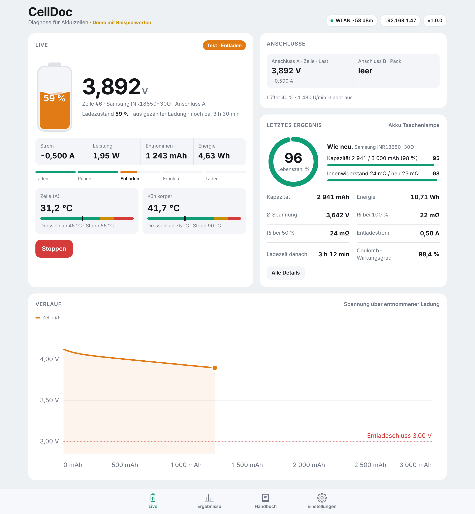
</picture>

> **Ausprobieren ohne Hardware:** [Demo im Browser](https://mariofritzer.github.io/CellDoc/) (Beispielwerte) · **Installieren:** [Webflasher](https://mariofritzer.github.io/CellDoc/flash/)

## Was CellDoc kann

- **Kapazitätstest** in einem Durchgang: voll laden → ruhen → mit Konstantstrom entladen → erholen → wieder voll oder auf Lagerspannung laden
- **Innenwiderstand (DC)** per Stromsprung, mehrmals während der Entladung, ausgewertet bei 100 % und 50 % Ladung
- **Lebenszahl** aus Kapazität und Innenwiderstand, mit Zelltyp-Datenbank und Schätzmodus für unbekannte Zellen
- **Zwei Anschlüsse:** A für Einzelzellen (laden und entladen), B für Packs bis 6S mit Balancer-Messung jeder Einzelzelle
- **Akkutypen:** Li-Ion, LiPo, Li-HV, LiFePO4, LTO, NiMH/NiCd und Blei
- **Bis 30 W / 8 A** Entladeleistung mit zwei Lastkanälen und Lüfter
- **Sicherheit:** drei Temperaturfühler mit Drosselung und Abschaltung, Über- und Unterspannung pro Zelle, Überstrom, Lüfter- und Sensorausfall, Not-Aus-Taste
- **Ergebnisse** mit Entladekurve, Ri-Verlauf und Vergleich zum ersten Test derselben Zelle
- **Zellenbestand** mit fester Nummer je Zelle (CD-0042), Suche nach Nummer, Name, Lagerort oder Notiz und Note A–D
- **Etiketten** mit Nummer, QR-Code und Messwerten als Bild für Etikettendrucker wie Supvan E16 oder Niimbot
- **Selbstentladungstest** über 7–14 Tage, findet Zellen mit innerem Kurzschluss
- **Pack zusammenstellen:** sucht gleich starke Zellen für z. B. 10S4P und verteilt sie gleichmäßig auf die Parallelgruppen
- **Home Assistant** über MQTT mit automatischer Erkennung, **Datensicherung** und CSV-Export
- **Handbuch** direkt im Gerät: Akkutypen, Bauformen, Stecker, Messwerte, Sicherheit, Lagerung und Entsorgung
- **Firmware-Updates** über den Browser, WLAN-Einrichtung über einen eigenen Hotspot

## Bilder

| Live | Ergebnisse | Ergebnis im Detail |
|:---:|:---:|:---:|
| 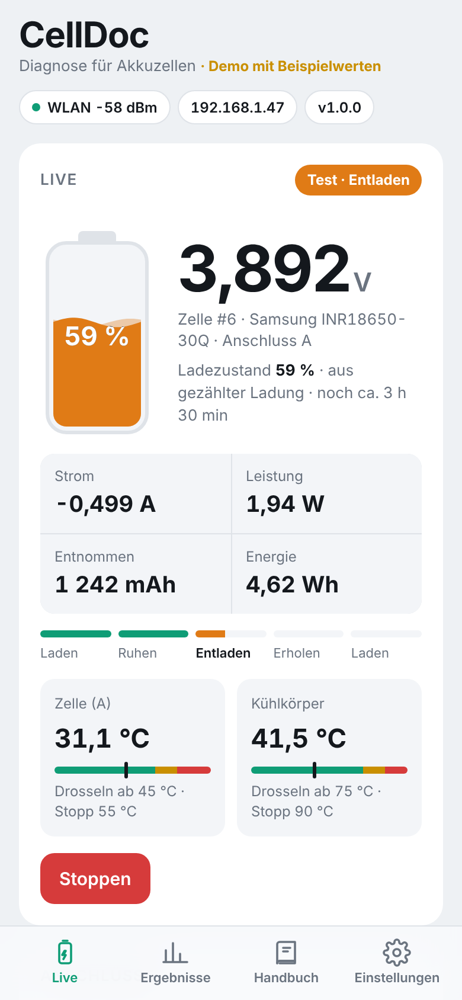 | 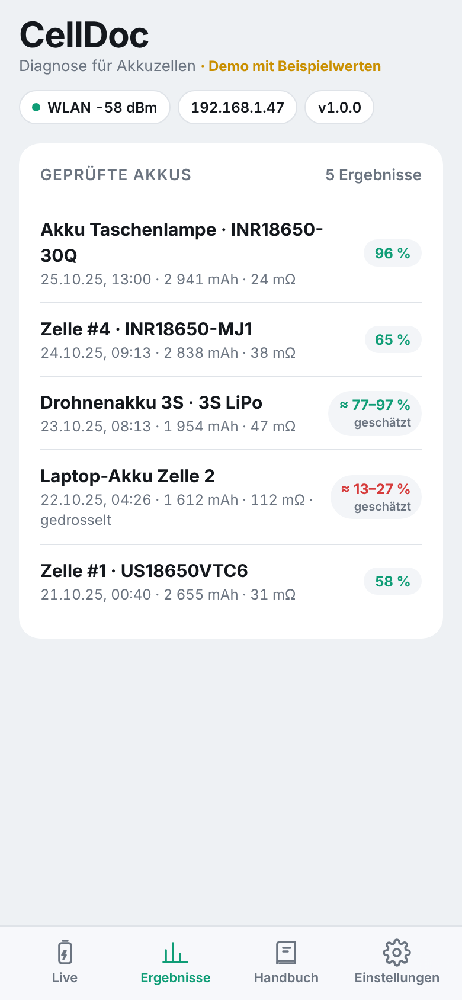 | 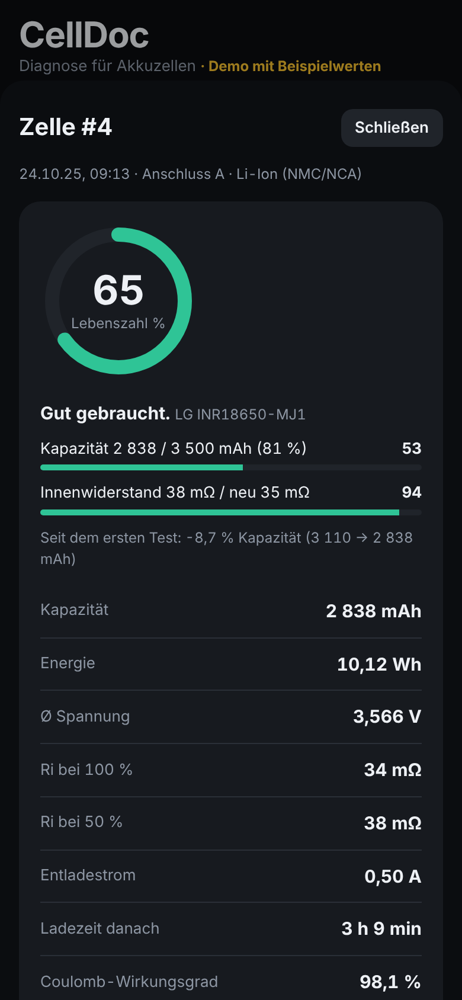 |

| Test starten | Handbuch | Einstellungen |
|:---:|:---:|:---:|
| 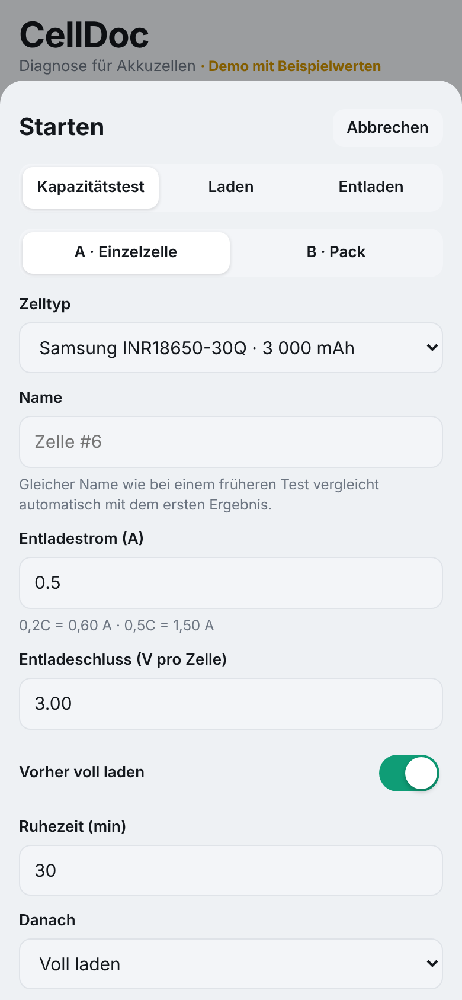 | 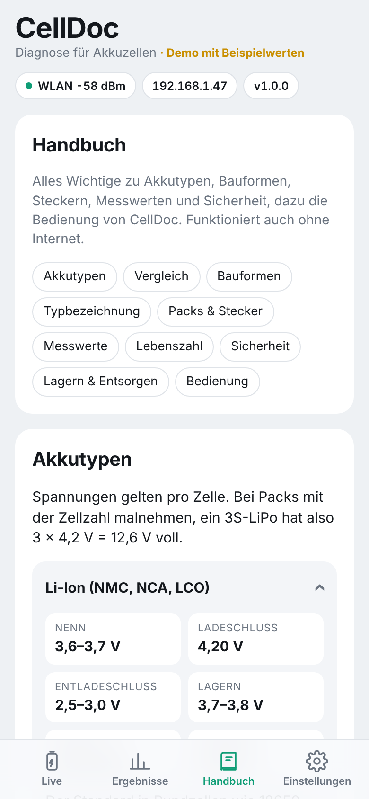 | 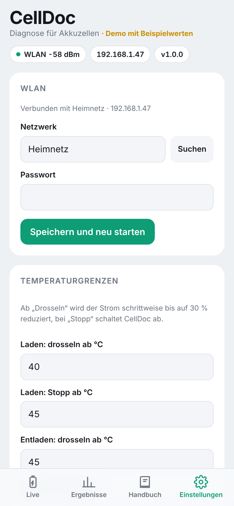 |

*Fotos vom fertigen Aufbau folgen.*

## Zellenbestand und Etiketten

Jeder Test legt die Zelle mit einer festen Nummer an. Die Nummer kommt mit einem Etikettendrucker auf die Zelle, der QR-Code darauf öffnet die Zelle später direkt in CellDoc. Beim nächsten Test wird sie aus dem Bestand gewählt und automatisch mit dem ersten Test verglichen.

| Bestand | Zelle | Etikett | Pack |
|:---:|:---:|:---:|:---:|
| 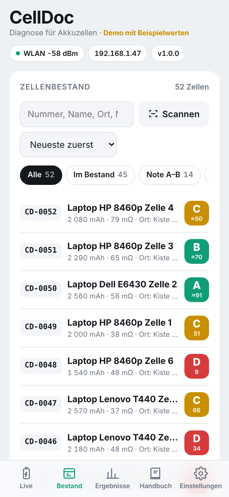 | 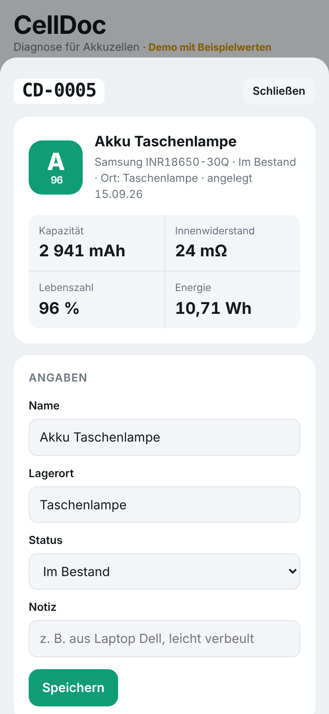 | 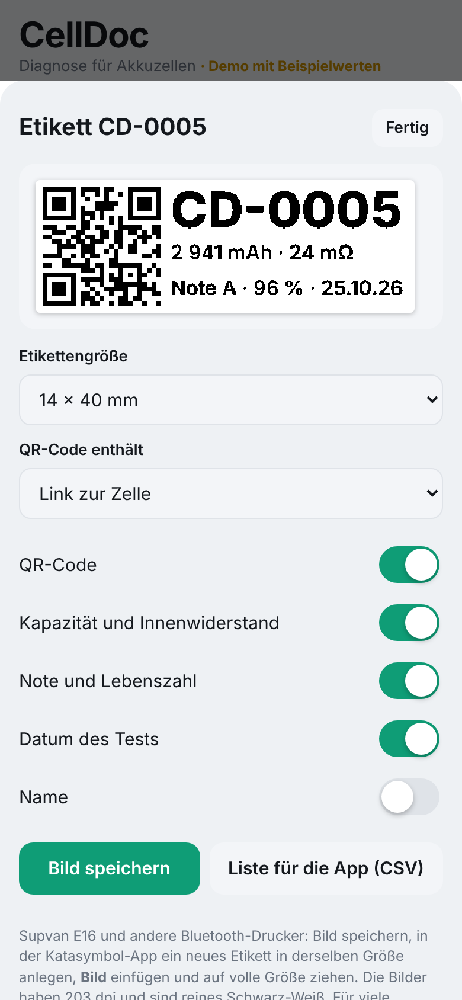 | 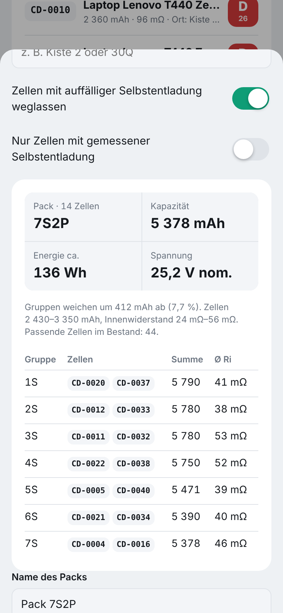 |

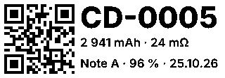

- **Etiketten:** 12–15 mm breit, 30–50 mm lang, 203 dpi, reines Schwarz-Weiß. Für den **Supvan E16**: Bild speichern und in der Katasymbol-App als Bild einfügen. Für viele Zellen auf einmal gibt es eine CSV-Liste für den Tabellenimport der App.
- **QR-Code scannen:** in der Weboberfläche über die Handykamera (Foto, über HTTPS auch live) oder mit einem optionalen Scanner-Modul (GM861S) direkt am Gerät. Die Zelle öffnet sich oder wird für den nächsten Test ausgewählt. Bei der Mini landet sie im Schacht, in den sie gesteckt wird.
- **Suche:** „42“ findet CD-0042, Wörter finden Name, Lagerort, Notiz oder Pack. Filter für Note A–B, „Prüfen“, verbaut und ausgemustert.
- **Selbstentladung:** Nach einem Test mit „Danach voll laden“ merkt sich CellDoc nach einer Stunde die Spannung. Nach 7–14 Tagen nachmessen, unter 3 mV pro Tag ist gut.
- **Pack zusammenstellen:** Serie und Parallel eingeben, CellDoc sucht passende Zellen, verteilt sie so, dass jede Parallelgruppe gleich viel Kapazität hat, und markiert sie auf Wunsch als verbaut.
- **Home Assistant:** Broker unter Einstellungen → MQTT eintragen, CellDoc erscheint von selbst als Gerät mit allen Messwerten und einer Stopp-Taste.
- **Datensicherung:** Bestand, Ergebnisse und Einstellungen als Datei sichern und wieder einspielen, dazu CSV-Export für Excel.

## Hardware

[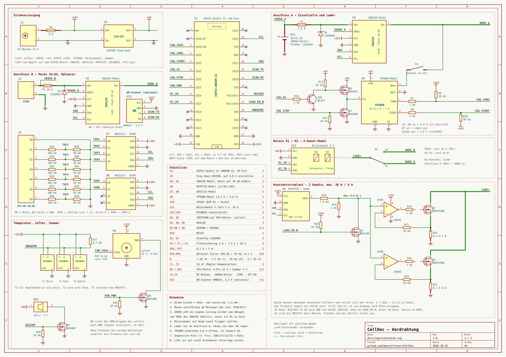](docs/img/schaltplan.svg)

**3D-Ansicht des Aufbaus** (Anordnungsvorschlag):

<picture>
  <source media="(prefers-color-scheme: dark)" srcset="docs/img/aufbau-dark.jpg">
  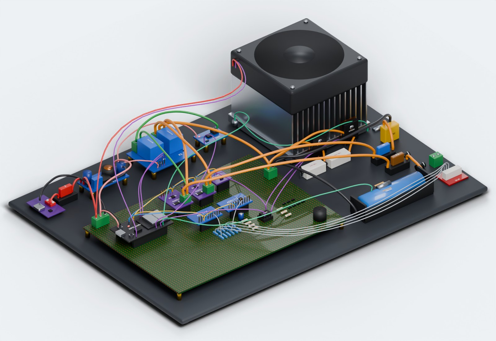
</picture>

**Anschlussplan** mit allen Modulen und Kabelfarben:

<picture>
  <source media="(prefers-color-scheme: dark)" srcset="docs/img/anschlussplan-dark.jpg">
  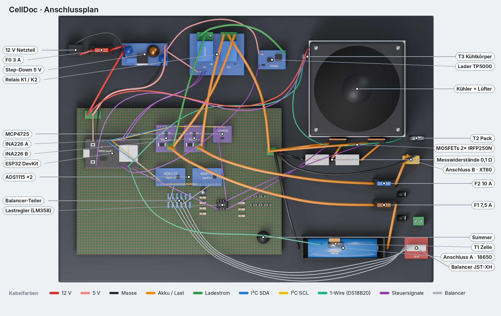
</picture>

<details><summary>Blockschaltbild</summary>

<picture>
  <source media="(prefers-color-scheme: dark)" srcset="docs/img/blockschaltbild-dark.png">
  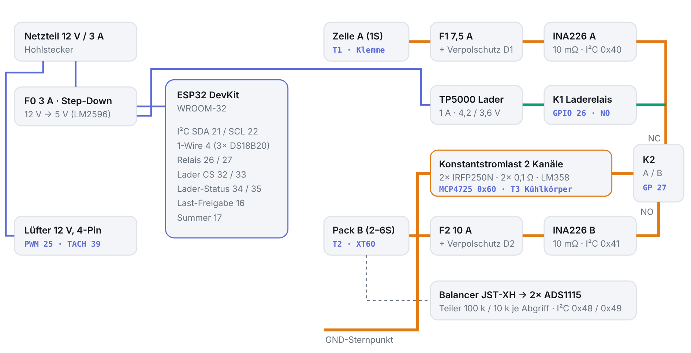
</picture>
</details>

ESP32 DevKit, 2× INA226 (Strom/Spannung), MCP4725 + LM358 + 2× IRFP250N (Konstantstromlast), TP5000 (Lader 4,2/3,6 V), 2× ADS1115 (Balancer), 3× DS18B20, zwei Relais, CPU-Kühler mit 4-Pin-Lüfter, 12-V-Netzteil.

Schaltung, Pinbelegung, optionaler QR-Scanner und Einkaufsliste: **[docs/hardware.md](docs/hardware.md)**

## CellDoc Mini

Die kleine Version nur für **18650 Li-Ion**: laden, entladen, Kapazität, Innenwiderstand und Lebenszahl, in drei Größen mit **1, 2 oder 4 Schächten**, die gleichzeitig laufen. 5-V-Netzteil, ein TP4056 und eine kleine Konstantstromlast pro Schacht (2 A bzw. 1 A bei vier Schächten), optional ein OLED mit drei Tastern. Weboberfläche und Ergebnisse sind dieselben wie beim großen CellDoc.

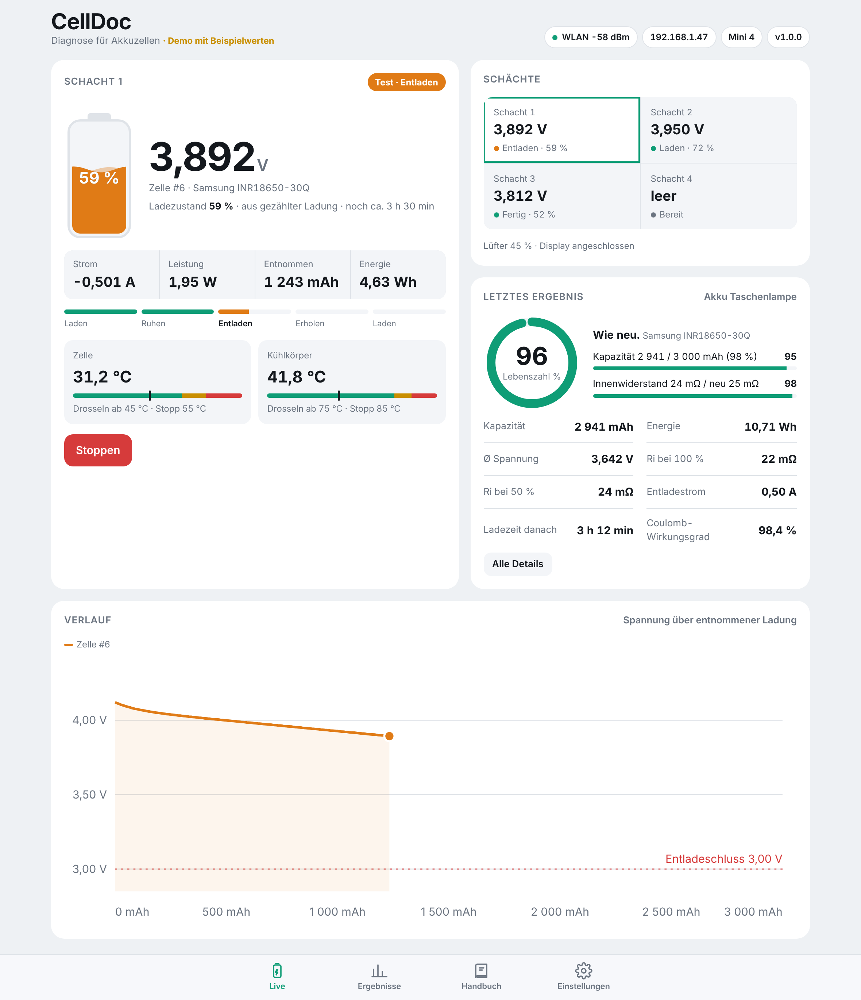

Schaltpläne für alle drei Varianten, Stücklisten und Bedienung: **[docs/mini.md](docs/mini.md)** · [Demo Mini 4](https://mariofritzer.github.io/CellDoc/?mini=4)

## Firmware installieren

### Erstinstallation per USB

Am einfachsten mit dem **[CellDoc Webflasher](https://mariofritzer.github.io/CellDoc/flash/)**: ESP32 per USB anschließen, im Chrome oder Edge Gerät wählen (CellDoc, Mini 1, 2 oder 4), *Verbinden und installieren*. Er spielt immer den neuesten Stand von `main` auf.

Von Hand: unter [Releases](../../releases) die Datei **`celldoc-factory.bin`** laden (Mini: `celldoc-mini1-factory.bin`, `-mini2-` oder `-mini4-`) und mit dem [ESP Web Flasher von Espressif](https://espressif.github.io/esptool-js/) an Adresse **0x0** schreiben.

Alternativ mit PlatformIO: `pio run -t upload`

### Updates

Unter **Einstellungen → Firmware-Update** die Datei **`celldoc-firmware.bin`** hochladen (Mini: `celldoc-mini<n>-firmware.bin`). Einstellungen und Ergebnisse bleiben erhalten.

## Erste Schritte

1. Ohne gespeichertes WLAN öffnet CellDoc den Hotspot **CellDoc-XXXX** mit dem Passwort **`celldoc1`**. Verbinden, die Seite öffnet sich automatisch, sonst `http://192.168.4.1` aufrufen.
2. **Einstellungen → WLAN**: Heimnetz wählen und speichern. Danach ist CellDoc unter **http://celldoc.local** oder seiner IP erreichbar.
3. **Einstellungen → Temperaturfühler**: prüfen, dass Zelle, Pack und Kühlkörper richtig zugeordnet sind.
4. **Einstellungen → Kalibrierung**: Spannung und Strom einmal mit dem Multimeter abgleichen.
5. **Live → Starten**: Zelltyp wählen, Strom einstellen, los.

## Die Lebenszahl

| Zelltyp | Gewichtung | Kapazität | Innenwiderstand |
|---|---|---|---|
| bekannt | 70 % Kapazität, 30 % Ri | 100 % Nennwert = 100 Punkte, 60 % = 0 | Neuwert = 100 Punkte, 2,5-facher Neuwert = 0 |
| unbekannt | 50 / 50 | gegen typischen Wert der Chemie | feste Grenzen pro Zelle |

Bei unbekannten Zellen zeigt CellDoc einen Bereich (z. B. „≈ 55–70 %“). Die hinterlegten Ri-Neuwerte sind Richtwerte für den DC-Innenwiderstand und lassen sich beim Start überschreiben. Die Berechnung liegt in [`src/soh.h`](src/soh.h) und wird mit [`test/test_soh.cpp`](test/test_soh.cpp) bei jedem Build geprüft.

## Selbst bauen

```bash
pip install platformio
pio run -e esp32dev            # baut Firmware und bettet web/index.html ein
pio run -e esp32dev -t upload  # flasht per USB
pio run -e mini2 -t upload     # CellDoc Mini mit 2 Schächten (mini1, mini2, mini4)
pio device monitor             # serielle Ausgabe, 115200 Baud
```

Die Weboberfläche ist eine einzelne Datei: [`web/index.html`](web/index.html). Direkt im Browser geöffnet startet sie im Demo-Modus, praktisch zum Entwickeln ohne Gerät. Beim Bauen packt `tools/embed_web.py` sie komprimiert in die Firmware.

| Pfad | Inhalt |
|---|---|
| `src/config.h` | Pins und harte Grenzwerte |
| `src/hal.*` | Messung, Last-Regelung, Lader, Relais, Lüfter |
| `src/tester.*` | Testablauf, Ri-Messung, Sicherheitsüberwachung |
| `src/profiles.h` | Akkuchemien und Zelltypen |
| `src/soh.h` | Lebenszahl und Note |
| `src/cells.*` | Zellenbestand, Selbstentladung |
| `src/mqtt.*` | Home Assistant über MQTT |
| `src/web_data.cpp` | Bestand, Datensicherung und Uhrzeit über die REST-API |
| `src/web.*` | WLAN, REST-API, Firmware-Update |
| `src/mini/` | CellDoc Mini: Schächte, OLED, eigene Web-API |
| `web/index.html` | Weboberfläche inkl. Handbuch |

Jeder Push auf `main` baut die Firmware über GitHub Actions und aktualisiert die Vorabversion `latest`. Ein Tag `v1.2.3` erzeugt ein normales Release.

## Status

Firmware und Weboberfläche sind vollständig, **auf echter Hardware aber noch nicht erprobt**. Vor dem ersten Test mit wertvollen Akkus bitte mit einer günstigen Zelle und kleinem Strom anfangen und die Werte mit einem Multimeter vergleichen.

## Sicherheit

Lithium-Akkus können bei Fehlern brennen. Tests mit hohen Strömen und LiPo-Packs nur auf nicht brennbarer Unterlage und nicht unbeaufsichtigt durchführen. Die Schutzfunktionen der Firmware ersetzen keine Aufsicht. Nachbau und Nutzung auf eigene Verantwortung.

## Lizenz

[MIT](LICENSE) © 2026 Mario Fritzer. Der eingebaute QR-Leser ist [jsQR](https://github.com/cozmo/jsQR) (Apache-2.0).

Die Idee geht auf das *ESP32 Smart Battery Dashboard* von LifeTronix zurück. Hardwarekonzept, Firmware und Oberfläche von CellDoc sind eigenständig neu entwickelt.
