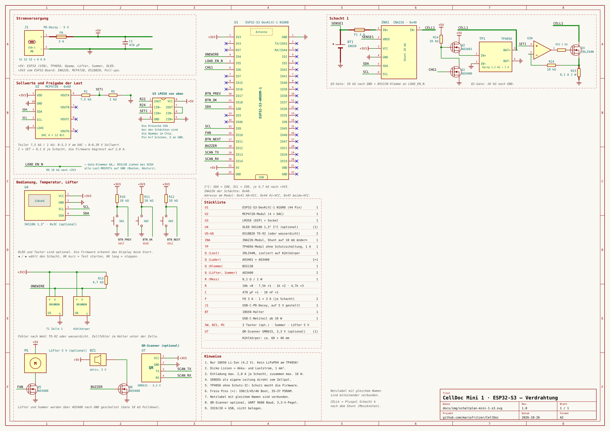
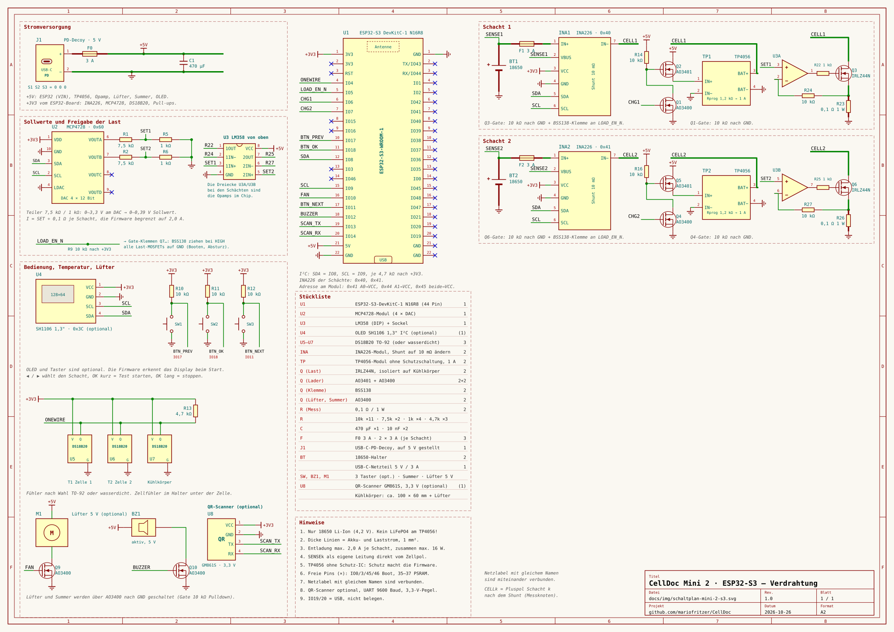
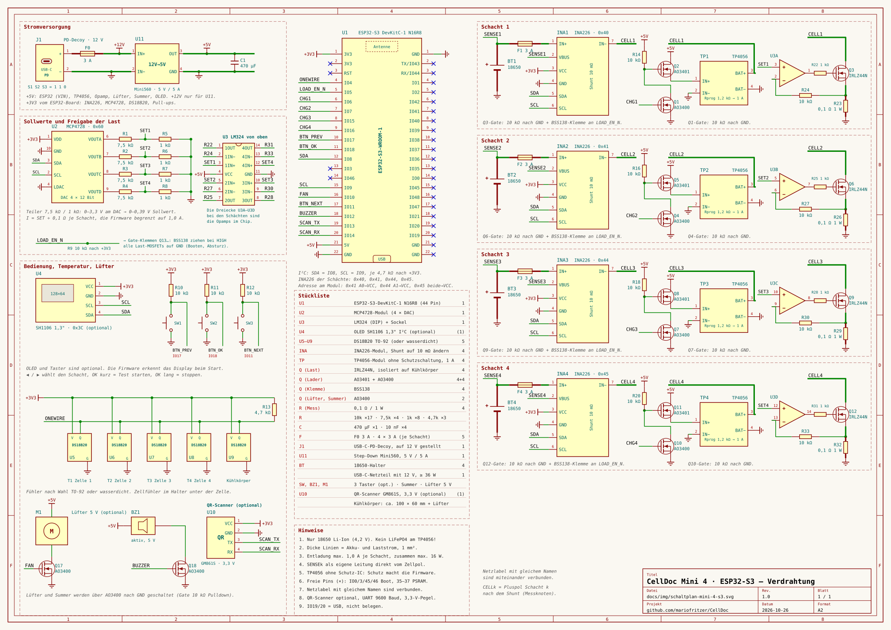

# CellDoc Mini

Die kleine Schwester von CellDoc: **nur 18650 Li-Ion**, dafür einfach nachzubauen und in drei Größen mit **1, 2 oder 4 Schächten**. Jeder Schacht lädt, entlädt mit Konstantstrom und misst Kapazität, Innenwiderstand und Lebenszahl, alle Schächte laufen unabhängig voneinander. Weboberfläche, Ergebnisse und Handbuch sind dieselben wie beim großen CellDoc.

> Noch weniger Teile: die **[CellDoc Nano](nano.md)** mit ESP32-C3 und festem Lastwiderstand.

> **Ausprobieren ohne Hardware:** [Demo Mini 2](https://mariofritzer.github.io/CellDoc/?mini=2) · [Demo Mini 4](https://mariofritzer.github.io/CellDoc/?mini=4)

| Live am Handy | Test starten |
|:---:|:---:|
|  |  |

## Unterschiede zum großen CellDoc

| | CellDoc | CellDoc Mini |
|---|---|---|
| Akkus | Li-Ion, LiPo, Li-HV, LiFePO4, LTO, NiMH, Blei, Packs bis 6S | nur 18650 Li-Ion |
| Anschlüsse | A (Zelle) + B (Pack mit Balancer) | 1, 2 oder 4 Schächte, alle gleichzeitig |
| Entladestrom | bis 8 A / 30 W | 2 A je Schacht (Mini 1/2), 1 A je Schacht (Mini 4), zusammen max. 16 W |
| Laden | TP5000, 4,2 V oder 3,6 V | TP4056 je Schacht, 1 A, 4,2 V |
| Versorgung | USB-C, Decoy auf 12 V | USB-C, Decoy auf 5 V (Mini 4: 12 V + 5-V-Regler) |
| Anzeige | Weboberfläche | Weboberfläche, optional OLED 1,3" mit drei Tastern |

## Schaltpläne

| Mini 1 | Mini 2 | Mini 4 |
|:---:|:---:|:---:|
|  |  |  |

Zum Vergrößern anklicken. Jeder Plan enthält Stückliste und Hinweise. Erzeugt werden sie mit `python3 tools/wiring_gen_mini.py <1|2|4> docs/img/schaltplan-mini-<n>.svg`.

### Temperaturfühler

**Temperaturfühler DS18B20: TO-92 oder wasserdicht, nach Wahl.**
- **TO-92 (empfohlen, vor allem an der Zelle):** reagiert schneller und liegt mit der flachen Seite gut an der Zelle an. Am besten fest in den Zellenhalter kleben (Wärmeleitkleber oder Kaptonband), so dass die eingesetzte Zelle darauf liegt. Beinchen mit Schrumpfschlauch isolieren, der Zellmantel ist Minus.
- **Wasserdicht (Edelstahlhülse mit Kabel):** robuster und fertig verkabelt, aber träger. Gut für den Kühlkörper, an der Zelle weniger.
- Beide Bauformen sind elektrisch gleich (rot = 3,3 V, schwarz/gelb je nach Hersteller = GND/Daten, im Zweifel nachmessen). Die Firmware erkennt beide.

### So funktioniert ein Schacht

- **Messung:** Ein INA226 pro Schacht (Adressen 0x40, 0x41, 0x44, 0x45: Schacht 2 mit A0 an VCC, Schacht 3 mit A1 an VCC, Schacht 4 mit beiden an VCC) misst Strom und Zellspannung. Den Shunt des Moduls auf **10 mΩ** tauschen, sonst reicht der Messbereich nicht. Die Spannung kommt über eine eigene Leitung (SENSE) direkt vom Zellpol.
- **Last:** Ein Kanal des MCP4728 gibt den Sollwert vor, ein Teiler 7,5 kΩ / 1 kΩ, ein Opamp (LM358 bei 1–2 Schächten, LM324 bei 4) und ein IRLZ44N mit 0,1-Ω-Messwiderstand machen daraus eine Konstantstromlast. Die Firmware regelt mit dem INA226 nach.
- **Laden:** Ein TP4056-Modul (1 A) pro Schacht, geschaltet über AO3400 + AO3401. Ist die Zelle zu warm, taktet die Firmware den Lader.
- **Sicherheit:** LOAD_EN_N (GPIO 16) hält über BSS138 alle Lasten gesperrt, solange der ESP32 nicht läuft oder bootet. Dazu eine Sicherung pro Schacht und eine im Netzteilzweig.

## Stückliste je Variante

| | Mini 1 | Mini 2 | Mini 4 |
|---|:---:|:---:|:---:|
| ESP32 DevKit V1 (WROOM-32, 30 Pin) | 1 | 1 | 1 |
| MCP4728-Modul (4-Kanal-DAC) | 1 | 1 | 1 |
| Opamp | LM358 | LM358 | LM324 |
| INA226-Modul, Shunt 10 mΩ | 1 | 2 | 4 |
| TP4056-Modul **ohne** Schutzschaltung, 1 A | 1 | 2 | 4 |
| IRLZ44N, isoliert auf Kühlkörper | 1 | 2 | 4 |
| AO3401 + AO3400 (Laderschalter) | 1 + 1 | 2 + 2 | 4 + 4 |
| BSS138 (Lastsperre) | 1 | 2 | 4 |
| AO3400 für Lüfter und Summer | 2 | 2 | 2 |
| Messwiderstand 0,1 Ω / 1 W | 1 | 2 | 4 |
| DS18B20, TO-92 oder wasserdicht (Zellen + Kühlkörper) | 2 | 3 | 5 |
| 18650-Halter | 1 | 2 | 4 |
| Sicherung je Schacht 3 A + Hauptsicherung 3 A | 1 + 1 | 2 + 1 | 4 + 1 |
| USB-C-PD-Decoy-Modul | auf 5 V | auf 5 V | auf 12 V |
| Step-Down Mini560, 5 V / 5 A | – | – | 1 |
| USB-C-Netzteil | ab 10 W | 5 V / 3 A (15 W) | mit 12 V, ab 36 W |
| Kühlkörper | ca. 60 × 40 mm | ca. 100 × 60 mm + Lüfter | ca. 100 × 60 mm + Lüfter |
| OLED SH1106 1,3" I²C + 3 Taster (optional) | ✓ | ✓ | ✓ |
| QR-Scanner GM861S, 3,3 V (optional) | ✓ | ✓ | ✓ |
| Summer, Widerstände, Kondensatoren | laut Schaltplan | | |

## Stromversorgung über USB-C

Alle Varianten bekommen ihren Strom über ein **USB-C-PD-Decoy-Modul** („PD/QC/AFC fast charge decoy trigger“). Es handelt mit dem Netzteil eine feste Spannung aus, eingestellt mit drei kleinen Schaltern auf der Rückseite:

| Spannung | S1 | S2 | S3 |
|---|:---:|:---:|:---:|
| 5 V | 0 | 0 | 0 |
| 9 V | 1 | 0 | 0 |
| **12 V** | **1** | **1** | **0** |
| 15 V | 0 | 1 | 0 |
| 20 V | 0 | 1 | 1 |

Die Tabelle steht auch auf der Platine. Es gibt Module mit anderer Belegung, im Zweifel gilt der Aufdruck. Das Modul liefert höchstens 3 A. Vor dem ersten Anschließen die Spannung am Ausgang mit dem Multimeter prüfen.

- **Mini 1 und Mini 2:** Decoy auf **5 V** (alle Schalter 0). Jedes USB-C-Netzteil geht, für die Mini 2 eines mit 3 A.
- **Mini 4:** Decoy auf **12 V** (S1 S2 S3 = 1 1 0) und dahinter ein Step-Down-Regler auf 5 V mit 5 A (z. B. Mini560). Vier Lader brauchen bis zu 4 A, deshalb lädt die Mini 4 ab Werk höchstens **3 Schächte gleichzeitig**, der vierte wartet kurz. Einstellbar unter Einstellungen → Gleichzeitig laden.
- Wer die Mini 4 ohne Regler direkt an 5 V / 3 A betreibt, stellt „höchstens 2 Schächte“ ein.

## Pinbelegung

| GPIO | Funktion |
|---|---|
| 21 / 22 | I²C SDA / SCL (INA226, MCP4728, OLED) |
| 4 | 1-Wire (DS18B20) |
| 16 | LOAD_EN_N: LOW = Lasten frei |
| 26, 27, 32, 33 | Lader Schacht 1–4 ein |
| 25 | Lüfter (PWM) |
| 17 | Summer |
| 34 / 35 / 39 | Taster ◀ / OK / ▶ (externe Pull-ups 10 kΩ) |
| 19 / 18 | QR-Scanner TX / RX (optional) |
| 0 | BOOT-Taste = Not-Aus |

### Variante mit ESP32-S3

Statt des ESP32 DevKit V1 geht auch ein **ESP32-S3-DevKitC-1 N16R8** (16 MB Flash, 8 MB PSRAM, zwei USB-C-Buchsen). Vorteile: rund 10 MB Speicher für Bestand und Kurven statt 896 KB, mehr Reserve, und die RGB-LED auf dem Board zeigt den Zustand (grün bereit, türkis lädt, orange entlädt, rot blinkend Fehler, blau blinkend Hotspot). Die Pinbelegung ist eine andere, alles Übrige bleibt gleich. Der Webflasher erkennt den S3 selbst; für Updates über die Weboberfläche die Dateien mit `-s3` im Namen nehmen.

- Nicht belegen: IO35–37 (gehören zum PSRAM), IO19/20 (USB), IO0/3/45/46 (Boot-Pins).
- Zum Flashen die USB-C-Buchse mit der Aufschrift **COM** (bzw. UART) nehmen, die zweite (USB) geht auch.

| Mini 1 · S3 | Mini 2 · S3 | Mini 4 · S3 |
|:---:|:---:|:---:|
|  |  |  |

| Funktion | ESP32 | ESP32-S3 |
|---|---|---|
| I²C SDA / SCL | 21 / 22 | 8 / 9 |
| 1-Wire DS18B20 | 4 | 4 |
| Last-Freigabe | 16 | 5 |
| Lader Schacht 1–4 | 26, 27, 32, 33 | 6, 7, 15, 16 |
| Lüfter | 25 | 10 |
| Summer | 17 | 12 |
| Taster ◀ / OK / ▶ | 34 / 35 / 39 | 17 / 18 / 11 |
| QR-Scanner TX / RX | 19 / 18 | 13 / 14 |
| BOOT = Not-Aus | 0 | 0 |
| RGB-LED auf dem Board | – | 48 |

## Bedienung

**Weboberfläche:** genau wie beim großen CellDoc (siehe [README](../README.md#erste-schritte)). Auf der Live-Seite zeigt die Kachel *Schächte* alle Schächte auf einen Blick. Ein Tipp wählt den Schacht, dann beziehen sich Anzeige, Starten, Stoppen und Kalibrierung auf ihn. Unter *Einstellungen → Temperaturfühler* bekommt jeder Schacht seinen Fühler (Zelle 1–4) und einer den Kühlkörper.

**OLED und Taster (optional):** Das Display wird beim Start automatisch erkannt, ohne Display läuft alles nur über den Browser.

| Taste | Wirkung |
|---|---|
| ◀ / ▶ | Schacht wählen |
| OK | Detailansicht ein/aus · Ergebnis oder Fehler bestätigen |
| OK in der Detailansicht eines freien Schachts | Standardtest: unbekannte 18650, 0,5 A, danach Lagerspannung |
| OK lang (1,2 s) | laufenden Vorgang im gewählten Schacht stoppen |
| BOOT | Not-Aus für alle Schächte |

## QR-Scanner (optional)

Ein fertiges Scanner-Modul liest die Etiketten direkt am Gerät. Es dekodiert den QR-Code selbst und schickt nur den Text über die serielle Schnittstelle (9600 Baud) an den ESP32.

| Scanner | ESP32 |
|---|---|
| VCC | 3V3 |
| GND | GND |
| TX | IO19 |
| RX | IO18 |

- Empfehlung: **GM861S** (3,3 V Versorgung und Pegel, ca. 15–20 €). Ein **GM65** geht auch, braucht aber 5 V Versorgung. Dann den TX des Scanners über einen Pegelwandler an IO19 legen.
- Den Scanner einmal auf **Induktionsmodus** (Sensing Mode) stellen. Dazu den passenden Einstell-Code aus seinem Handbuch scannen. Dann liest er automatisch, sobald ein Etikett davor gehalten wird.
- Die Firmware erkennt den Scanner von selbst. Unter Einstellungen → Diagnose steht dann „QR-Scanner: ok“.

**Ablauf:** Zelle mit dem Etikett vor den Scanner halten, es piept kurz. Ein langer Ton bedeutet, dass der Code unbekannt ist. Steckt gerade genau eine Zelle in einem freien Schacht, wird sie diesem Schacht zugeordnet, sonst dem nächsten Schacht, in den innerhalb von 2 Minuten eine Zelle gesteckt wird. Das Display zeigt die Nummer, **OK** startet den Test mit dieser Zelle, und im Startdialog der Weboberfläche ist sie vorausgewählt.

## Firmware

Am einfachsten mit dem **[Webflasher](https://mariofritzer.github.io/CellDoc/flash/?dev=mini2)** im Chrome oder Edge: Variante wählen, *Verbinden und installieren*.

Alternativ gibt es unter [Releases](https://github.com/mariofritzer/CellDoc/releases) für jede Variante zwei Dateien:

| Variante | Erstinstallation (Adresse 0x0) | Update über die Weboberfläche |
|---|---|---|
| Mini 1 | `celldoc-mini1-factory.bin` | `celldoc-mini1-firmware.bin` |
| Mini 2 | `celldoc-mini2-factory.bin` | `celldoc-mini2-firmware.bin` |
| Mini 4 | `celldoc-mini4-factory.bin` | `celldoc-mini4-firmware.bin` |

Selbst bauen: `pio run -e mini2 -t upload` (bzw. `mini1`, `mini4`). Der Code liegt in [`src/mini/`](../src/mini), WLAN, Speicher, Einstellungen und Weboberfläche teilt sich die Mini mit dem großen CellDoc.

## Sicherheit

- **Nur Li-Ion mit 4,2 V Ladeschluss.** LiFePO4, LiHV oder NiMH gehören nicht in die Mini: Der TP4056 lädt fest auf 4,2 V.
- Die TP4056-Module haben bewusst **keine Schutzschaltung**, weil die die Entlademessung verfälschen würde. Über- und Unterspannung, Überstrom und Temperatur überwacht die Firmware. Ohne Fühler an der Zelle startet ein Schacht nicht.
- Beschädigte, aufgeblähte oder tiefentladene Zellen (unter 2,5 V) werden nicht geprüft.
- Auf nicht brennbarer Unterlage betreiben und nicht unbeaufsichtigt laufen lassen.

Auch die Mini ist **auf echter Hardware noch nicht erprobt**. Zuerst mit einer günstigen Zelle und kleinem Strom testen und die Werte mit einem Multimeter vergleichen.
