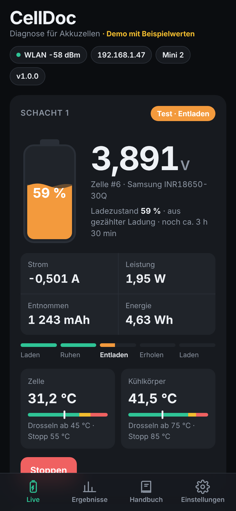
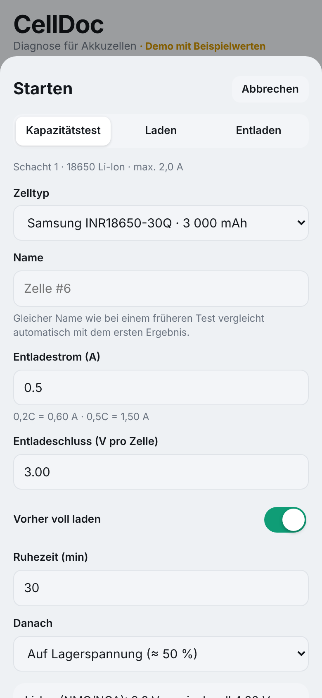
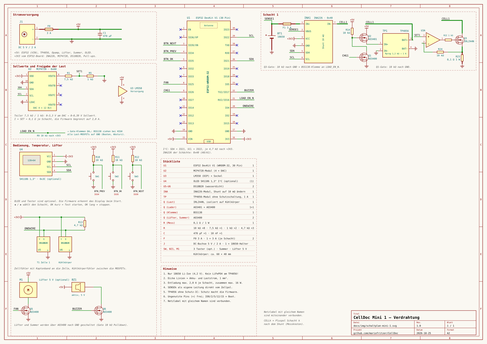
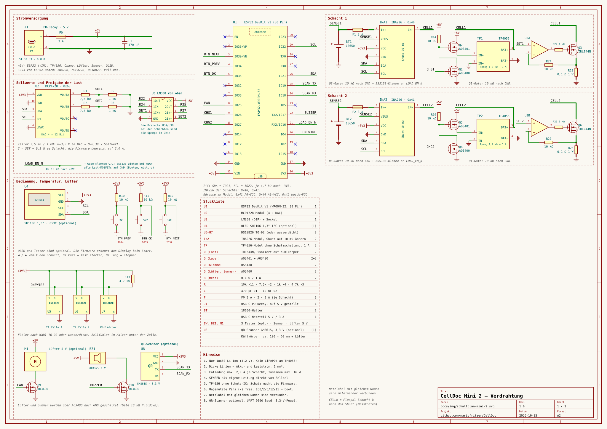
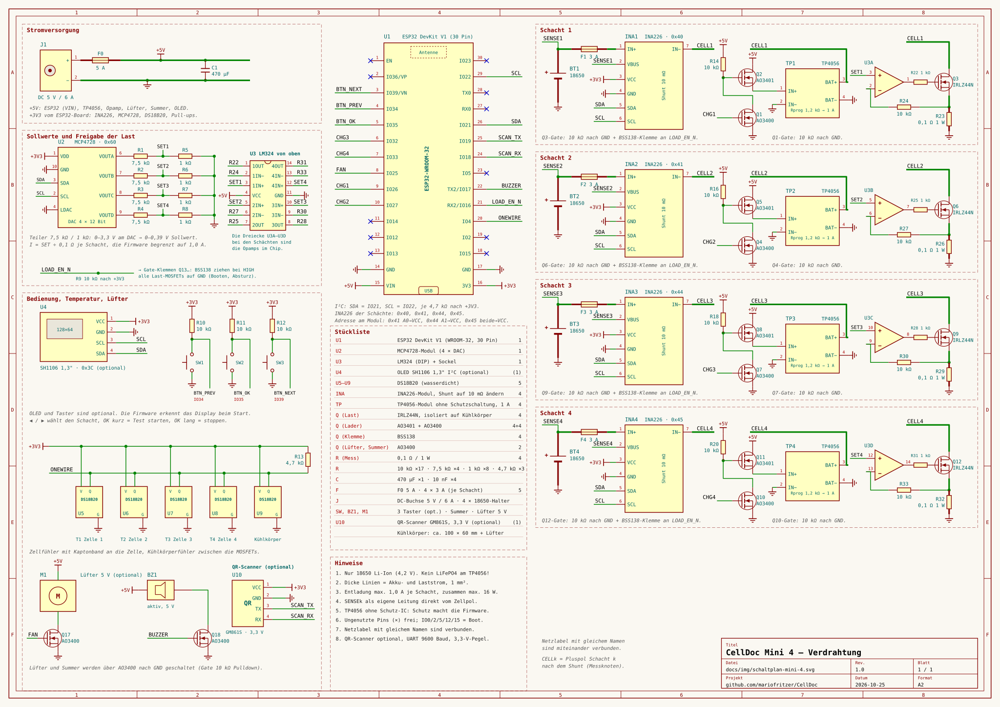

# CellDoc Mini

Die kleine Schwester von CellDoc: **nur 18650 Li-Ion**, dafür einfach nachzubauen und in drei Größen mit **1, 2 oder 4 Schächten**. Jeder Schacht lädt, entlädt mit Konstantstrom und misst Kapazität, Innenwiderstand und Lebenszahl, alle Schächte laufen unabhängig voneinander. Weboberfläche, Ergebnisse und Handbuch sind dieselben wie beim großen CellDoc.

> **Ausprobieren ohne Hardware:** [Demo Mini 2](https://mariofritzer.github.io/CellDoc/?mini=2) · [Demo Mini 4](https://mariofritzer.github.io/CellDoc/?mini=4)

| Live am Handy | Test starten |
|:---:|:---:|
|  |  |

## Unterschiede zum großen CellDoc

| | CellDoc | CellDoc Mini |
|---|---|---|
| Akkus | Li-Ion, LiPo, Li-HV, LiFePO4, LTO, NiMH, Blei, Packs bis 6S | nur 18650 Li-Ion |
| Anschlüsse | A (Zelle) + B (Pack mit Balancer) | 1, 2 oder 4 Schächte, alle gleichzeitig |
| Entladestrom | bis 8 A / 30 W | 2 A je Schacht (Mini 1/2), 1 A je Schacht (Mini 4), zusammen max. 16 W |
| Laden | TP5000, 4,2 V oder 3,6 V | TP4056 je Schacht, 1 A, 4,2 V |
| Netzteil | 12 V | 5 V (USB-Netzteil oder Steckernetzteil) |
| Anzeige | Weboberfläche | Weboberfläche, optional OLED 1,3" mit drei Tastern |

## Schaltpläne

| Mini 1 | Mini 2 | Mini 4 |
|:---:|:---:|:---:|
|  |  |  |

Zum Vergrößern anklicken. Jeder Plan enthält Stückliste und Hinweise. Erzeugt werden sie mit `python3 tools/wiring_gen_mini.py <1|2|4> docs/img/schaltplan-mini-<n>.svg`.

### So funktioniert ein Schacht

- **Messung:** Ein INA226 pro Schacht (Adresse 0x40 + Schacht − 1) misst Strom und Zellspannung. Den Shunt des Moduls auf **10 mΩ** tauschen, sonst reicht der Messbereich nicht. Die Spannung kommt über eine eigene Leitung (SENSE) direkt vom Zellpol.
- **Last:** Ein Kanal des MCP4728 gibt den Sollwert vor, ein Teiler 7,5 kΩ / 1 kΩ, ein Opamp (LM358 bei 1–2 Schächten, LM324 bei 4) und ein IRLZ44N mit 0,1-Ω-Messwiderstand machen daraus eine Konstantstromlast. Die Firmware regelt mit dem INA226 nach.
- **Laden:** Ein TP4056-Modul (1 A) pro Schacht, geschaltet über AO3400 + AO3401. Ist die Zelle zu warm, taktet die Firmware den Lader.
- **Sicherheit:** LOAD_EN_N (GPIO 16) hält über BSS138 alle Lasten gesperrt, solange der ESP32 nicht läuft oder bootet. Dazu eine Sicherung pro Schacht und eine im Netzteilzweig.

## Stückliste je Variante

| | Mini 1 | Mini 2 | Mini 4 |
|---|:---:|:---:|:---:|
| ESP32 DevKit V1 (WROOM-32, 30 Pin) | 1 | 1 | 1 |
| MCP4728-Modul (4-Kanal-DAC) | 1 | 1 | 1 |
| Opamp | LM358 | LM358 | LM324 |
| INA226-Modul, Shunt 10 mΩ | 1 | 2 | 4 |
| TP4056-Modul **ohne** Schutzschaltung, 1 A | 1 | 2 | 4 |
| IRLZ44N, isoliert auf Kühlkörper | 1 | 2 | 4 |
| AO3401 + AO3400 (Laderschalter) | 1 + 1 | 2 + 2 | 4 + 4 |
| BSS138 (Lastsperre) | 1 | 2 | 4 |
| AO3400 für Lüfter und Summer | 2 | 2 | 2 |
| Messwiderstand 0,1 Ω / 1 W | 1 | 2 | 4 |
| DS18B20 wasserdicht (Zellen + Kühlkörper) | 2 | 3 | 5 |
| 18650-Halter | 1 | 2 | 4 |
| Sicherung je Schacht 3 A + Hauptsicherung | 1 + 3 A | 2 + 3 A | 4 + 5 A |
| Netzteil 5 V | 2 A | 3 A | 6 A |
| Kühlkörper | ca. 60 × 40 mm | ca. 100 × 60 mm + Lüfter | ca. 100 × 60 mm + Lüfter |
| OLED SH1106 1,3" I²C + 3 Taster (optional) | ✓ | ✓ | ✓ |
| Summer, Widerstände, Kondensatoren | laut Schaltplan | | |

## Pinbelegung

| GPIO | Funktion |
|---|---|
| 21 / 22 | I²C SDA / SCL (INA226, MCP4728, OLED) |
| 4 | 1-Wire (DS18B20) |
| 16 | LOAD_EN_N: LOW = Lasten frei |
| 26, 27, 32, 33 | Lader Schacht 1–4 ein |
| 25 | Lüfter (PWM) |
| 17 | Summer |
| 34 / 35 / 39 | Taster ◀ / OK / ▶ (externe Pull-ups 10 kΩ) |
| 0 | BOOT-Taste = Not-Aus |

## Bedienung

**Weboberfläche:** genau wie beim großen CellDoc (siehe [README](../README.md#erste-schritte)). Auf der Live-Seite zeigt die Kachel *Schächte* alle Schächte auf einen Blick. Ein Tipp wählt den Schacht, dann beziehen sich Anzeige, Starten, Stoppen und Kalibrierung auf ihn. Unter *Einstellungen → Temperaturfühler* bekommt jeder Schacht seinen Fühler (Zelle 1–4) und einer den Kühlkörper.

**OLED und Taster (optional):** Das Display wird beim Start automatisch erkannt, ohne Display läuft alles nur über den Browser.

| Taste | Wirkung |
|---|---|
| ◀ / ▶ | Schacht wählen |
| OK | Detailansicht ein/aus · Ergebnis oder Fehler bestätigen |
| OK in der Detailansicht eines freien Schachts | Standardtest: unbekannte 18650, 0,5 A, danach Lagerspannung |
| OK lang (1,2 s) | laufenden Vorgang im gewählten Schacht stoppen |
| BOOT | Not-Aus für alle Schächte |

## Firmware

Unter [Releases](https://github.com/mariofritzer/CellDoc/releases) gibt es für jede Variante zwei Dateien:

| Variante | Erstinstallation (Adresse 0x0) | Update über die Weboberfläche |
|---|---|---|
| Mini 1 | `celldoc-mini1-factory.bin` | `celldoc-mini1-firmware.bin` |
| Mini 2 | `celldoc-mini2-factory.bin` | `celldoc-mini2-firmware.bin` |
| Mini 4 | `celldoc-mini4-factory.bin` | `celldoc-mini4-firmware.bin` |

Selbst bauen: `pio run -e mini2 -t upload` (bzw. `mini1`, `mini4`). Der Code liegt in [`src/mini/`](../src/mini), WLAN, Speicher, Einstellungen und Weboberfläche teilt sich die Mini mit dem großen CellDoc.

## Sicherheit

- **Nur Li-Ion mit 4,2 V Ladeschluss.** LiFePO4, LiHV oder NiMH gehören nicht in die Mini: Der TP4056 lädt fest auf 4,2 V.
- Die TP4056-Module haben bewusst **keine Schutzschaltung**, weil die die Entlademessung verfälschen würde. Über- und Unterspannung, Überstrom und Temperatur überwacht die Firmware. Ohne Fühler an der Zelle startet ein Schacht nicht.
- Beschädigte, aufgeblähte oder tiefentladene Zellen (unter 2,5 V) werden nicht geprüft.
- Auf nicht brennbarer Unterlage betreiben und nicht unbeaufsichtigt laufen lassen.

Auch die Mini ist **auf echter Hardware noch nicht erprobt**. Zuerst mit einer günstigen Zelle und kleinem Strom testen und die Werte mit einem Multimeter vergleichen.
