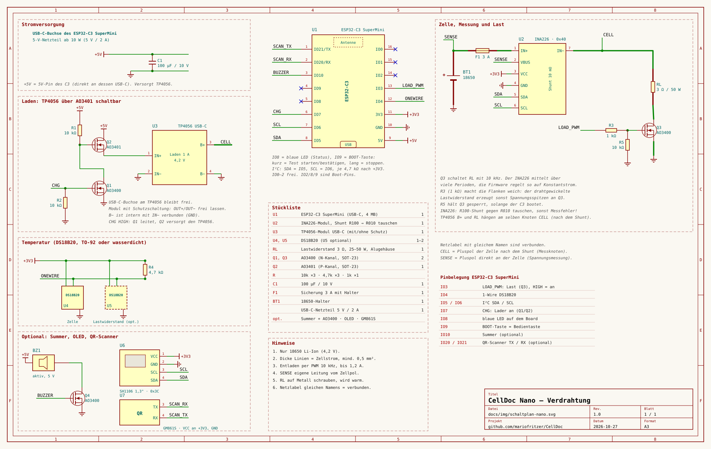
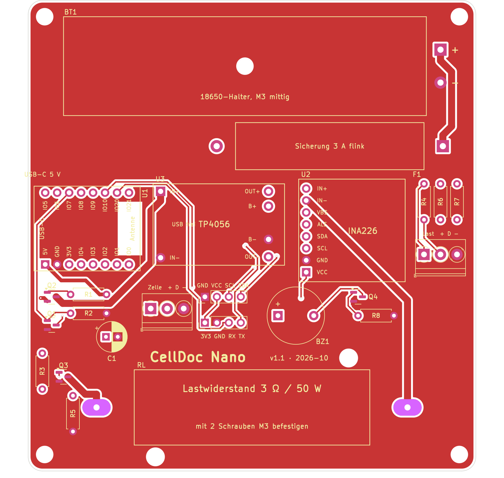
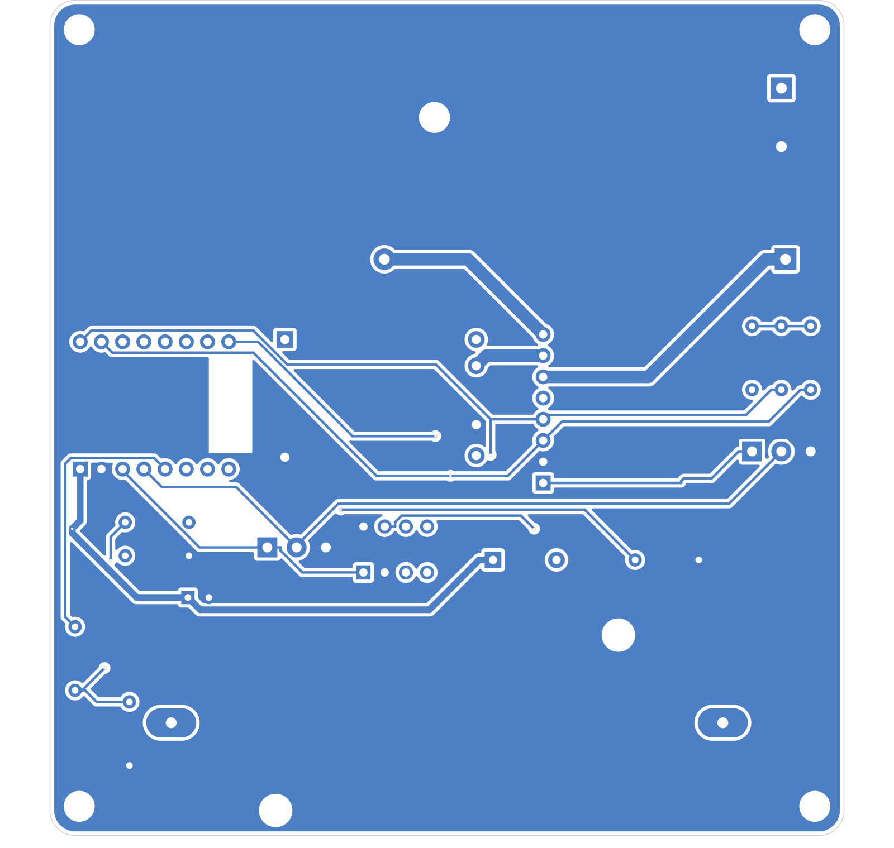

# CellDoc Nano

Die kleinste Variante von CellDoc: **ein Schacht für 18650 Li-Ion**, ein ESP32-C3 SuperMini und so wenig Teile wie möglich. Statt einer geregelten Konstantstromlast mit DAC und Opamp gibt es nur einen festen **Lastwiderstand (3 Ω)**, den ein MOSFET mit 10 kHz taktet. Der INA226 mittelt den Strom, die Firmware regelt das Tastverhältnis und erreicht so trotzdem echten Konstantstrom. Laden, Kapazität, Innenwiderstand, Lebenszahl, Bestand, Etiketten, QR, MQTT und Sync mit den anderen Geräten funktionieren wie bei der Mini.

> **Ausprobieren ohne Hardware:** [Demo Nano](https://mariofritzer.github.io/CellDoc/?nano=1)

## Unterschiede zur Mini

| | CellDoc Mini 1 | CellDoc Nano |
|---|---|---|
| Board | ESP32 DevKit V1 oder ESP32-S3 | ESP32-C3 SuperMini |
| Last | MCP4728 + Opamp + IRLZ44N, bis 2 A | fester Widerstand 3 Ω + AO3400, PWM, bis 1,2 A |
| Entladestrom konstant | über den ganzen Test | bis 0,8 A über den ganzen Test, darüber nur bei voller Zelle |
| Kühlung | Kühlkörper + Lüfter | Lastwiderstand im Alugehäuse, auf Metall geschraubt |
| Versorgung | PD-Decoy-Modul | USB-C-Buchse des C3, jedes 5-V-Netzteil ab 10 W |
| Bedienung am Gerät | optional OLED + 3 Taster | BOOT-Taste und blaue LED auf dem Board, OLED optional |
| Teile | ca. 25 | ca. 12 |

## Schaltplan

Zum Vergrößern anklicken. Erzeugt mit `python3 tools/wiring_gen_nano.py docs/img/schaltplan-nano.svg`.

### So funktioniert sie

- **Messung:** INA226 an 0x40. Den Shunt des Moduls (Aufdruck R100) gegen einen **R010 (10 mΩ, Bauform 2512)** tauschen. Mit R100 übersteuern die Stromspitzen der PWM den Messeingang und die Werte stimmen nicht. Die Spannung kommt über eine eigene Leitung (SENSE) direkt vom Zellpol.
- **Last:** Lastwiderstand 3 Ω von CELL nach Drain von Q3 (AO3400), Source an GND. Das Gate hängt über **1 kΩ** an IO3 und über **10 kΩ** an GND. Der 1 kΩ macht die Schaltflanken weicher, weil der drahtgewickelte Widerstand beim Abschalten sonst Spannungsspitzen erzeugt.
- **Laden:** TP4056-Modul (1 A). Q2 (AO3401) schaltet seine 5-V-Versorgung, Q1 (AO3400) an IO7 steuert Q2. Solange entladen wird, ist der Lader also wirklich aus. Die USB-C-Buchse am TP4056 bleibt frei. Bei Modulen mit Schutzschaltung OUT+ und OUT− frei lassen, B− ist intern mit IN− verbunden.
- **Strom:** Bei 3 Ω fließen bei voller Zelle höchstens 1,4 A, bei 3,0 V noch 1 A. Bei **0,8 A** (Voreinstellung) bleibt der Strom bis zur Abschaltspannung konstant, ein 3000-mAh-Test dauert dann etwa 4 h. Bis 1,2 A sind einstellbar, darunter sinkt der Strom gegen Testende ab (die Kapazität stimmt trotzdem, sie wird gezählt).
- **Innenwiderstand:** Die Last wird regelmäßig für eine Sekunde abgeschaltet. Aus dem Spannungssprung ergibt sich der Innenwiderstand.
- **Temperatur:** DS18B20 an der Zelle (Pflicht). Ein zweiter am Lastwiderstand ist optional. Der erste erkannte Fühler gilt als Zellfühler, der zweite als Lastwiderstand. Unter Einstellungen → Temperaturfühler lässt sich das ändern.

## Stückliste

| Menge | Teil | Anmerkung |
|---|---|---|
| 1 | ESP32-C3 SuperMini (USB-C, 4 MB) | |
| 1 | INA226-Modul | Shunt R100 → R010 tauschen |
| 1 | Shunt-Widerstand 10 mΩ, 2512 (R010) | |
| 1 | TP4056-Modul mit USB-C | mit oder ohne Schutzschaltung |
| 1 | Lastwiderstand 3 Ω, 25–50 W, Alugehäuse | auf Metall schrauben |
| 2 | AO3400 (N-Kanal, SOT-23) | Q1 Laderschalter, Q3 Last |
| 1 | AO3401 (P-Kanal, SOT-23) | Q2 Laderschalter |
| 1–2 | DS18B20, TO-92 oder wasserdicht | Zelle, optional Lastwiderstand |
| 3 | Widerstand 10 kΩ | R1, R2, R5 |
| 3 | Widerstand 4,7 kΩ | 1-Wire und I²C-Pull-ups |
| 1 | Widerstand 1 kΩ | Gate Q3 |
| 1 | Elko 100 µF / 10 V | an +5V |
| 1 | Sicherung 3 A mit Halter | im Pluspfad der Zelle |
| 1 | 18650-Halter | |
| 1 | USB-C-Netzteil 5 V / 2 A | |
| opt. | Summer (aktiv, 5 V) + AO3400, OLED SH1106, QR-Scanner GM861S | |

## Pinbelegung

| GPIO | Funktion |
|---|---|
| 3 | LOAD_PWM: Last (Q3), HIGH = an |
| 4 | 1-Wire (DS18B20) |
| 5 / 6 | I²C SDA / SCL (INA226, OLED) |
| 7 | CHG: Lader an (Q1 → Q2) |
| 8 | blaue LED auf dem Board |
| 9 | BOOT-Taste = Bedientaste |
| 10 | Summer (optional) |
| 20 / 21 | QR-Scanner TX / RX (optional) |

IO0–2 sind frei. IO2, IO8 und IO9 sind Boot-Pins, deshalb liegen dort nur LED und Taste.

## Bedienung am Gerät

- **BOOT-Taste kurz:** Standardtest starten (gescannte oder neue Zelle, 0,8 A, danach Lagerspannung) bzw. ein Ergebnis oder einen Fehler bestätigen.
- **BOOT-Taste lang (über 1 s):** laufenden Vorgang stoppen.
- **Blaue LED:** kurzer Blitz alle 3 s = bereit, langsam blinkend = lädt, an = entlädt, Doppelblitz = fertig, schnell blinkend = Fehler, zwei kurze Blitze pro Sekunde = Hotspot (WLAN noch nicht eingerichtet).

## Platine

| Oberseite | Unterseite |
|:---:|:---:|
|  |  |

Zweilagig, 95 × 100 mm, beidseitig GND-Fläche. Alles sitzt auf der Platine: die Module über Buchsenleisten, der 18650-Halter, der Sicherungshalter und der Lastwiderstand. KiCad-Projekt und Gerber-Dateien liegen in [`hardware/nano-pcb/`](../hardware/nano-pcb/), `CellDoc-Nano-gerber.zip` geht direkt an JLCPCB & Co. (1,6 mm, 1 oz, Standardregeln).

**Zusätzliche Teile für die Platine**

| Menge | Teil | Anmerkung |
|---|---|---|
| 3 | Buchsenleiste 1 × 8, Raster 2,54 mm | 2 × C3 SuperMini, 1 × INA226 |
| 6 | einzelne Stifte (von einer Stiftleiste abgebrochen) | TP4056, seine Lötpunkte liegen nicht im 2,54-mm-Raster |
| 2 | Schraubklemme 3-polig, Raster 3,5 mm | J2/J3, DS18B20 wasserdicht |
| 3 | Schraube M3 + Mutter | Halter (1) und Lastwiderstand (2) |
| opt. | Stift- oder Buchsenleiste 1 × 4 | J4 OLED, J5 QR-Scanner |

**Aufbau**

- **18650-Halter:** mit einer M3-Schraube durch das Loch in der Mitte befestigen. Die Kabel kürzen und in die Lötaugen rechts löten: rot an +, schwarz an −.
- **Sicherungshalter:** liegt unter dem Zellhalter. Die Kabel kürzen und in die beiden Lötaugen links und rechts löten, den Halter mit einem Tropfen Heißkleber fixieren.
- **Lastwiderstand:** mit zwei M3-Schrauben durch die Laschen festschrauben, die Lötfahnen auf die beiden ovalen Lötaugen biegen und anlöten. Er wird bei 0,8 A etwa handwarm, bei 1,2 A deutlich warm.
- **Temperaturfühler:** Klemme „Zelle“ (Pflicht) und „Last“ (optional, Fühler an den Lastwiderstand kleben). + = rot (3,3 V), D = gelb/weiß (Daten), − = schwarz (GND).
- **INA226:** R100-Shunt gegen R010 tauschen, bevor das Modul aufgesteckt wird. R6/R7 (I²C-Pull-ups) weglassen, das Modul hat eigene.
- **TP4056:** Die USB-Buchse am Modul bleibt frei, Strom kommt über die USB-C-Buchse des C3 links an der Kante. Die Lochpositionen stammen aus der Maßzeichnung (27,9 × 17,3 mm), vor der Bestellung am eigenen Modul nachmessen.
- **C3 SuperMini:** Reihenabstand 15,24 mm, USB-C zeigt nach links über die Kante. Unter der Antenne liegt kein Kupfer.
- **Summer:** Platz ist vorgesehen (aktiver 5-V-Summer, Raster 7,6 mm), bestücken kann man ihn später.
- Zum Platine neu erzeugen: `tools/pcb/build.sh` (KiCad-Python + Freerouting). Zu dieser Platine gibt es noch keinen KiCad-Schaltplan, deshalb in KiCad **nicht** „Platine aus Schaltplan aktualisieren“ ausführen.

## Firmware

- **Webflasher:** [mariofritzer.github.io/CellDoc/flash](https://mariofritzer.github.io/CellDoc/flash/), Gerät „Nano“ wählen. Der Port heißt meist „USB JTAG/serial debug unit“. Klappt das Verbinden nicht, BOOT gedrückt halten, USB einstecken, dann loslassen.
- **Von Hand:** `celldoc-nano-factory.bin` aus den Releases an Adresse 0x0.
- **Update:** `celldoc-nano-firmware.bin` unter Einstellungen → Firmware-Update.
- **Selbst bauen:** `pio run -e nano -t upload`

## Hinweise

- Der C3 SuperMini hat eine kleine Antenne. Die Firmware senkt die Sendeleistung, weil viele dieser Boards mit voller Leistung kein WLAN finden.
- Der Lastwiderstand wird bei 0,8 A mit etwa 2 W warm, bei 1,2 A mit bis zu 4,5 W. Auf eine Metallplatte oder die Gehäusewand geschraubt bleibt er handwarm.
- Die Kabel an billigen 18650-Haltern sind oft sehr dünn. Kurz halten oder gegen 0,5 mm² tauschen. SENSE direkt am Zellpol abgreifen, dann verfälschen Halter und Kabel die Spannung nicht.
- Firmware und Schaltplan sind noch **nicht auf echter Hardware erprobt**. Erst mit einer günstigen Zelle testen und Spannung und Strom mit dem Multimeter vergleichen (Kalibrierung unter Einstellungen).
